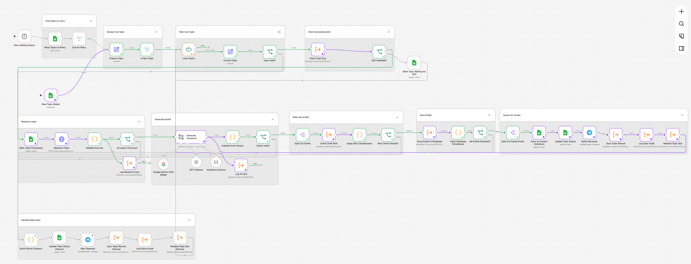
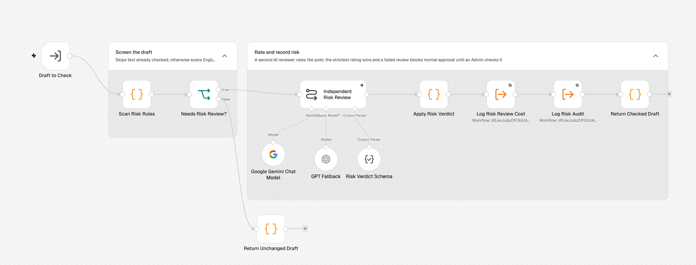
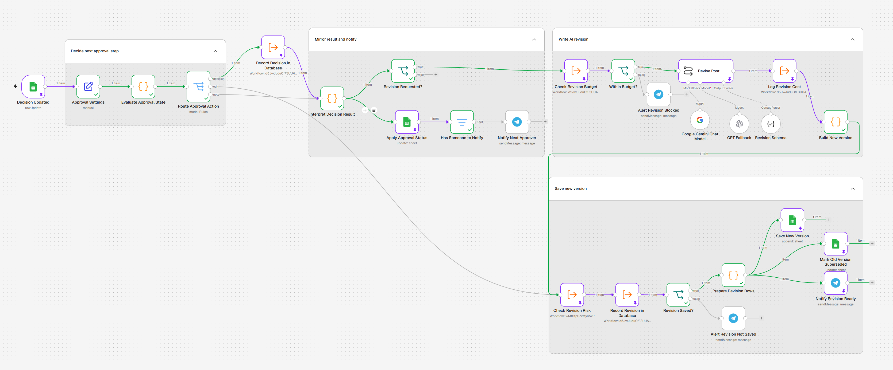
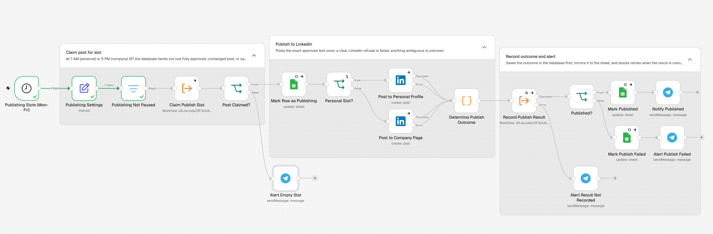
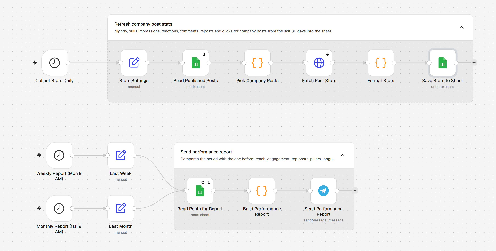
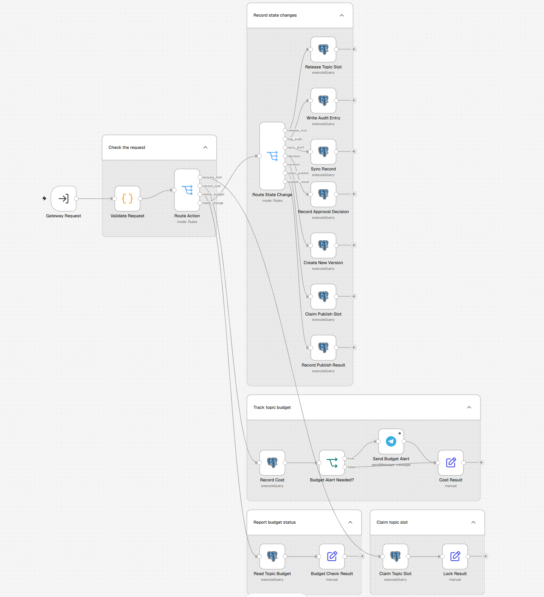
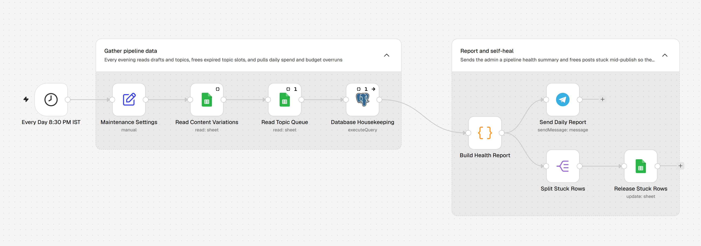
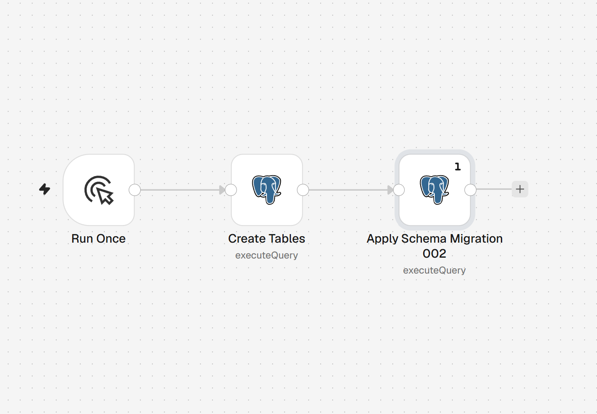

# linkedin_complete_suite
We're designing a LinkedIn Complete Suite to automate the entire process, from generating LinkedIn content to following up with clients.

## LinkedIn Content - Topic to Review Queue

## LinkedIn Content - Risk Check

## LinkedIn Content - Approval Manager

## LinkedIn Content - Scheduled Publisher

## LinkedIn Content - Post Stats & Reports

## LinkedIn Content - DB Gateway

## LinkedIn Content - Daily Maintenance

## LinkedIn Content - Database Setup

